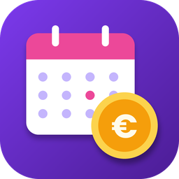

# LifeDesk

**Finanze, agenda, task e note personali in un unico posto.**
Per Android e Windows.

### [⬇️ Vai alla pagina di download](https://andre-xii.github.io/lifedesk/)

---

## ✨ Cosa puoi fare

| | |
|---|---|
| 💶 **Finanze** | Conti, movimenti, trasferimenti tra conti, scadenze e pagamenti ricorrenti, tutto in un colpo d'occhio. |
| 📈 **Investimenti** | Portfolio e piani di accumulo (PAC). Controllo mensile: a fine mese ti ricorda di inserire il valore dei piani e calcola profitti, perdite e storico con grafico. |
| 🧮 **Disponibilità e risparmi** | La Home mostra la disponibilità totale, i risparmi a parte e il patrimonio netto. |
| 📊 **Insights** | Analisi di entrate e uscite, grafici degli ultimi mesi e riepilogo mensile. |
| 📅 **Agenda e task** | Eventi, cose da fare con scadenza e priorità, e la finestra "Oggi" per vedere subito la giornata. |
| 🔖 **Spazio personale** | Appunti, link e checklist con formattazione, tag e note riservate protette dalla biometria. Vista a elenco + pannello oppure a card. Puoi allegare foto, file e documenti. |
| 🔔 **Promemoria** | Notifiche per scadenze e pagamenti in arrivo (Android). |
| 📄 **Esportazione** | Report PDF e export dei tuoi dati. |
| 🌍 **Multi-valuta** | Euro, dollaro, sterlina e franco svizzero. |
| 🔒 **Privacy** | Accesso con codice via email o password, biometria su Android e pulsante per oscurare le cifre. |

### 📱 Su Android
- **Widget in home** con disponibilità, risparmi, patrimonio, entrate e uscite del mese, task di oggi e prossimi pagamenti.
- Accesso rapido con impronta o volto.

### 🖥️ Su Windows
- **Mini finestra "Oggi"** sempre in primo piano con le task del giorno.
- Avvio automatico con Windows: finestra normale, icona nelle icone nascoste, oppure solo la mini finestra.
- Installazione per l'utente attuale o per tutti gli utenti.

---

## 📥 Installazione

<b>📱 Android</b>

1. Scarica **LifeDesk.apk** dalla [pagina di download](https://andre-xii.github.io/lifedesk/) o dalle [release](https://github.com/andre-xii/lifedesk/releases/latest).
2. Aprilo. Se richiesto, consenti **"Installa app da questa fonte"** al browser.
3. Conferma l'installazione. Se compare un avviso di Play Protect, scegli **"Installa comunque"**.

<b>🖥️ Windows</b>

1. Scarica **LifeDesk-Setup.exe**.
2. Eseguilo. Se Windows mostra la schermata SmartScreen, premi **Ulteriori informazioni → Esegui comunque**.
3. Scegli se installare **solo per te** oppure per **tutti gli utenti**.
4. Avvia LifeDesk dal Menu Start (o dal desktop, se hai lasciato l'icona).

> ℹ️ Windows e Android possono mostrare un avviso perché l'app non è distribuita tramite Microsoft Store o Google Play.

---

## 🔄 Aggiornamenti

LifeDesk controlla da solo se esiste una versione più nuova e te lo segnala all'avvio. Puoi anche controllare a mano da **Impostazioni → Info e aggiornamenti**.

- **Windows:** scarica l'installer, lo avvia in silenzio e riapre l'app aggiornata.
- **Android:** scarica l'APK e apre l'installazione di sistema.

Le versioni precedenti e le novità di ognuna sono nella sezione [**Releases**](https://github.com/andre-xii/lifedesk/releases).

---

## ❓ Domande frequenti

<b>Serve un account?</b>

Sì. Al primo accesso crei un account con la tua email e i tuoi dati restano legati a quell'account: sono visibili solo a te.

<b>Dove sono salvati i miei dati?</b>

Su un database cloud personale (Supabase), protetto da regole di accesso per utente. Le note dello Spazio personale e i loro allegati sono privati ma non cifrati end-to-end: meglio non salvarci password, PIN delle carte o documenti d'identità.

<b>L'app è gratuita?</b>

Sì, è un progetto personale e non contiene pubblicità.

<b>Android rifiuta l'aggiornamento: perché?</b>

Gli aggiornamenti devono essere firmati con la stessa chiave dell'app già installata. Se succede, disinstalla LifeDesk e reinstalla l'ultima versione (i dati sono sul tuo account e restano al sicuro).

<b>Funziona su iPhone o Mac?</b>

Al momento no: le versioni disponibili sono Android e Windows.

---

## 🛠️ Segnalazioni e idee

Hai trovato un problema o hai un'idea? Apri una [**segnalazione**](https://github.com/andre-xii/lifedesk/issues) indicando dispositivo, versione dell'app e cosa è successo.

---

Fatto con 💜 e Flutter · © LifeDesk. Tutti i diritti riservati.

